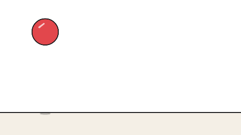
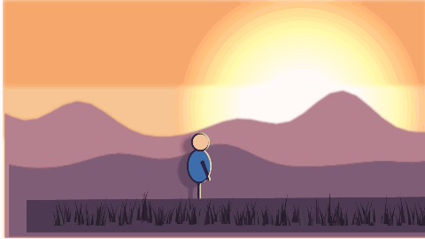
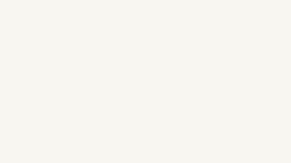

# anima2D

A self-hosted 2D animation studio for the browser, made for the iPad and Apple Pencil.
Draw frame by frame with onion skin and a timeline, colour under your linework, tween and
rig what you would rather not redraw, and export for YouTube and Shorts. Everything lives
on your own server; the editor keeps working when that server is off.

## See it

Three example projects, rendered by the app's own renderer (the GIFs are the files in
[`examples/`](examples), drawn the way an export draws them):

| | | |
|---|---|---|
|  |  |  |
| **Bouncing ball.** Frame by frame on twos: squash and stretch, key, breakdown and inbetween marks, a shadow on the colour plane under the line. | **Sunset walk.** Layers at five depths for parallax, a sun light layer, a walk cycle with a drop shadow and rim light, a camera push-in with depth of field and a dusk tint. | **Title card.** Text animated with layer keyframes (scale, turn, fade), a subtitle typed on with Typewriter, a light sweeping across. |

To open one: on the project list choose **Import…** and pick its `.anima2d.json` file.

## How it works

1. **Draw.** Pick a brush on the toolbar and draw with the Pencil; fingers pan, zoom and
   turn the canvas, and never draw. Each drawing sits on the timeline, as wide as it is
   held.
2. **Time it.** Add drawings, set how long each holds, mark keys and breakdowns, and flip
   through with the onion skin showing the drawings around this one. Let Inbetween draw
   the in-betweens, or move a part along a path.
3. **Stage it.** Layers for background, characters and foreground; give them depth, light
   them, move whole layers with keyframes, and frame the shot with camera keys.
4. **Export it.** A YouTube or Shorts preset, on the device (MP4, PNG frames, GIF) or on
   the Mac (H.264, HEVC, ProRes with transparency).

Every edit is saved on the device at once and on your server a moment later; another
device, or an agent drawing through MCP, shows up in an open project within a second or
two.

## What it does

**Drawing**
- Pencil-first: pressure and tilt, a line stabiliser, and palm rejection (fingers never
  draw; one finger pans, two pan, zoom and rotate; two- and three-finger taps undo and redo).
- Brushes: pen, pencil (with grain), marker, and paint, which goes under the lines.
- Scatter brushes: grass, birds, stars, leaves, flowers and spray, stamped along the stroke
  (each stroke is seeded, so it renders the same every time).
- Shapes: line, rectangle, ellipse and triangle, outlined or filled, snapping to squares,
  circles and 15° lines. Curves: drag, then bend with a handle.
- Fill bucket that closes small gaps and fills under the lines; eyedropper.
- Pixel eraser and object eraser (removes whole strokes, shapes and fills).
- Selection: tap or lasso; move, scale, rotate, flip, restack, recolour, duplicate, copy
  and paste between drawings.
- Mirror symmetry; hold the pen still at the end of a line to straighten it.
- Text in any of the browser's fonts or in font files added to the project: bold,
  italic, aligned, turned; select it to move and scale it like any item.
- Pictures: a background picture (a layer of its own, held to the end) or a picture in
  any drawing, to move, scale, turn, mirror and animate.
- Project colours kept with the project; recolour every item in one colour at once.
- Guides: title- and action-safe frames and a grid with the thirds marked.

**Animating**
- Layers, bottom to top: drawing layers, background layers (drawn once, held to the end),
  and reference images or videos to trace over.
- A reference board (W): pictures and videos kept beside the canvas while you draw, saved
  with the project. Zoom and pan each one, let a video follow the playhead or play on its
  own, take a colour from it, or trace it as a layer.
- A timeline with a row per layer; each drawing is as wide as it is held. Marks for keys,
  breakdowns and inbetweens. Scrub the ruler (audio follows, for lip sync); loop a range,
  play ping-pong or slowed down.
- Onion skin before and after, tinted or in original colours, or keys only; pin any
  drawing to the light table; shift and trace slides the skins to trace a part anew.
- Layer keyframes: the Transform tool moves, scales, turns and fades a whole layer about
  its pivot, keyed at the playhead, with easing; the path shows on the canvas.
- Blend modes per layer (multiply, screen, overlay, add, darken, lighten), and clipping
  a layer to the one below for shading inside the lines.
- Typewriter: a text typed on a letter or a word at a time.
- Sequences: reverse, duplicate, repeat as a cycle, ping-pong, delete.
- Inbetween: drawings between two others, by matching their items (strokes morph,
  shapes interpolate, colours blend), with easing.
- Move along a path: draw a path and a selection travels it, optionally turning with it.
- Camera: frame the shot by panning and zooming, set keys, and playback moves between them.
  Each key can add handheld shake, depth of field (a layer in focus, the others blurred by
  how far they are from it) and a tint over the frame for time of day or mood.
- Depth: give layers a distance (near, foreground, canvas, background, far) and camera
  moves get parallax, near layers sliding faster than far ones.
- Lighting: light layers (a soft pool or a band of coloured light, added to what is under
  them, or multiplied as a shadow light; moved and animated with Transform); a drop shadow
  and a rim light on any drawing layer that follow its drawings on every frame.
- Audio tracks with waveforms, offsets and mute.
- Rigging (cut-out): bones on a layer's first drawing, parts bound to bones, poses on the
  other drawings (turn a bone, or Shift to reach with the whole chain); inbetweening two
  poses turns the bones in arcs.

**Saving and exporting**
- Project files: download any project from its menu on the list (`.anima2d.json`) and import
  it on another server, or start from an example.
- Every edit is saved on the device at once and on the server shortly after. With the
  server unreachable the app still opens (a service worker caches it) and edits sync when
  it is back. Saves are revisioned: two devices, or the editor and an agent, never
  overwrite each other; a conflicting version is kept as a copy. Changes from another
  device or an agent show within a second or two: the editor and the project list wait on
  the server (long-polling) instead of asking every few seconds.
- Export presets for YouTube 4K, 2K, 1080p, 720p and Shorts, and presets of your own.
  Export on the device (WebCodecs MP4, PNG frames in a ZIP, or an animated GIF), or render
  on the Mac through the render agent (H.264 and HEVC on VideoToolbox, or ProRes 4444).
  A transparent background is kept by PNG frames, GIFs and ProRes.

## Desktop app

A native editor, written in Haskell with GTK3, that runs on macOS and Linux:

```sh
just desktop
```

It opens projects from a folder on this computer (the server's own store runs inside
the app, so it works without a network) or from your anima2D server (its address, plus
any headers your sign-in gate needs). It shares the project format and the parsers with
the server, so projects move freely between the browser, the iPad and the desktop. Its
renderer is drawn with Cairo and matches the browser's.

It draws with the browser's brushes (pen, pencil, marker, paint), scatter brushes, the
eraser, shapes, text and the paint bucket; selects, moves, scales and turns items; adds,
duplicates and holds drawings and layers, with undo and onion skin; and it updates live
when another device or an agent saves. The sidebar holds the reference board (videos
need ffmpeg on the PATH) and the assistant.

A layer's panel (double-click its name in the timeline) sets its name, opacity, blend,
clipping, depth, drop shadow, rim light and, for a light, the light; the camera tool (C)
frames the shot on the paper and keys its zoom, turn, shake, depth of field and tint at
the playhead. Export renders the film at the browser's presets as MP4 (H.264 or HEVC),
ProRes 4444 with transparency, GIF or PNG frames, with the audio mixed in (ffmpeg).

The assistant is a chat with a model of your choosing that draws and animates in the open
project with the same tools agents get over MCP, plus a look at the frame it drew. Connect
it with the gear: Anthropic (an API key; it uses Claude Opus 5.5), or any server that
speaks OpenAI's chat completions, such as OpenAI or a local model in Ollama or LM Studio.
The key stays in the system keychain. Each change it makes is an ordinary edit you can
undo.

`just desktop-ui` drives the real window offscreen (drawing, undo, selection, the board,
the assistant with a scripted model, saving) and writes snapshots of it to `desktop/ui-snapshots/`.

`anima2d-desktop render <project.anima2d.json> <frame> <width> <out.png>` draws one frame
without opening a window.

## Layout

| Path | What |
|---|---|
| `src/`, `app/`, `test/` | The server, in Haskell: the projects API, uploads, the render queue, MCP |
| `web/` | The editor, in TypeScript (Vite, no UI framework) |
| `render/` | The Mac render agent (Node, Skia, ffmpeg VideoToolbox) |
| `desktop/` | The native desktop editor (Haskell, GTK3, Cairo) |
| `fixtures/` | Parser cases both test suites run: accept, upgrade and reject alike |
| `examples/` | Example projects to import, their preview GIFs, and the script that builds them (`just examples`) |
| `docs/conventions.md` | **Parse, don't validate** and the other house rules; read first |

## Developing

```sh
just serve   # API on 127.0.0.1:9215, projects in ./data
just web     # editor with hot reload on :5173 (proxies /api to the server)
just test    # Haskell specs, then ESLint + vitest
```

`cd web && npm install` once before `just web`. After changing `web/package-lock.json`,
run `just npm-hash` so the Nix build pins the new dependencies.

### Keyboard

| Key | Action |
|---|---|
| `V` `Q` `B` `G` `E` `U` `T` `K` `I` `R` | Select, transform, brush, scatter, eraser, shapes, text, fill, eyedropper, rig |
| `[` / `]` | Smaller / larger brush |
| `,` / `.` | Previous / next drawing; `←` / `→` one frame |
| `N` / `D` | New / duplicate drawing |
| `Space` | Play / pause; `L` loops the selection |
| `O` | Onion skin; `P` pins the drawing to the light table; `M` mirror |
| `⌘Z` / `⇧⌘Z` | Undo / redo; `⌘C` `⌘V` `⌘D` `⌘A` on selections |
| `0` / `F` | Fit to screen / fullscreen |

Mouse and trackpad: the left button draws; the wheel and a pinch zoom; Shift+scroll, a
sideways swipe, Space+drag or the middle button pan; right-click (long-press on the iPad)
opens the menu. Drag the toolbar by its grip to either edge; drag the timeline's top edge
to resize it.

## API

| Method | Path | |
|---|---|---|
| `GET` | `/healthz` | `ok` |
| `GET` | `/api/projects` | Project summaries |
| `GET` | `/api/projects/:id` | A project; its revision in `X-Revision` |
| `GET` | `/api/projects/:id/summary` | Its summary (cheap; editors poll it) |
| `PUT` | `/api/projects/:id` | Save; `X-Base-Revision` names the revision it started from, 409 if stale |
| `DELETE` | `/api/projects/:id` | Delete (the files move to `trash/` under the projects folder) |
| `GET` | `/api/changes?after=N` | Long-poll: answers when anything is saved after save N (or after 20 s), with the latest number |
| `POST` | `/api/assets` | Upload an image, video, audio or font file (streamed, 512 MB at most) |
| `GET` | `/api/assets/:id` | Download it (range requests work) |
| `POST` | `/api/renders` | Queue a render for the Mac: `{"project_id", "preset"}` |
| `GET` | `/api/renders` | Render statuses |
| `GET` | `/api/renders/:id/video` | The finished video (MP4, or a ProRes .mov) |

The server has no login of its own; put it behind a single sign-on proxy (for example
your reverse proxy asking an OAuth2 proxy before every request).

## MCP

`anima2d serve --mcp-port 9216` adds an MCP server (streamable HTTP, `POST /mcp`) so agents
can draw: `list_projects`, `get_project`, `create_project`, `add_layer`, `get_drawing`,
`add_items`, `replace_items`, `add_drawing`, `set_layer` (blend, clipping, motion keys, depth,
effects, light), `add_light`, `set_camera` (keys with shake, depth of field and tint),
`preview` (a frame as a PNG the model can see, drawn by the Mac's render agent), `undo` and
`redo` (over the last 100 saved versions), and `item_format`, the reference of the item and motion JSON with examples. Items go through the same parser as the editor's saves, so a mistake
comes back as the exact rejection; writes are revisioned, so an open editor shows them.
It listens on loopback only; publish it behind the same kind of sign-in gate as the editor.

## The render agent

Video renders and MCP previews can run on a Mac, using its GPU, when the server has none.
The server writes a job into `renders/queue` under the projects folder, which the server
and the Mac share (a network or synced folder); the agent draws each frame with the
editor's own renderer (on Skia), pipes it to ffmpeg's VideoToolbox encoder, and leaves the
video in `renders/done`.

```sh
cd render && npm install && npm run build && ANIMA2D_DATA=/path/to/projects ./install.sh
```

installs it as a LaunchAgent (`anima2d.render-agent`, logging to
`~/Library/Logs/anima2d-render.log`), watching the projects folder in `ANIMA2D_DATA`
(default `~/anima2d/projects`). Re-run after changing the project format, so the agent
parses what the editor writes.

## Deploying

A push to `main` runs `.forgejo/workflows/deploy.yaml` on a self-hosted Actions runner on
the server's host: it checks and builds the flake and hands the store path to a deploy
socket on that host, which switches the profile and rolls back if `/healthz` does not
answer. Any other way of running `anima2d serve` works too; the flake's package is the
server with the built editor beside it.

## Licence

Apache-2.0.
